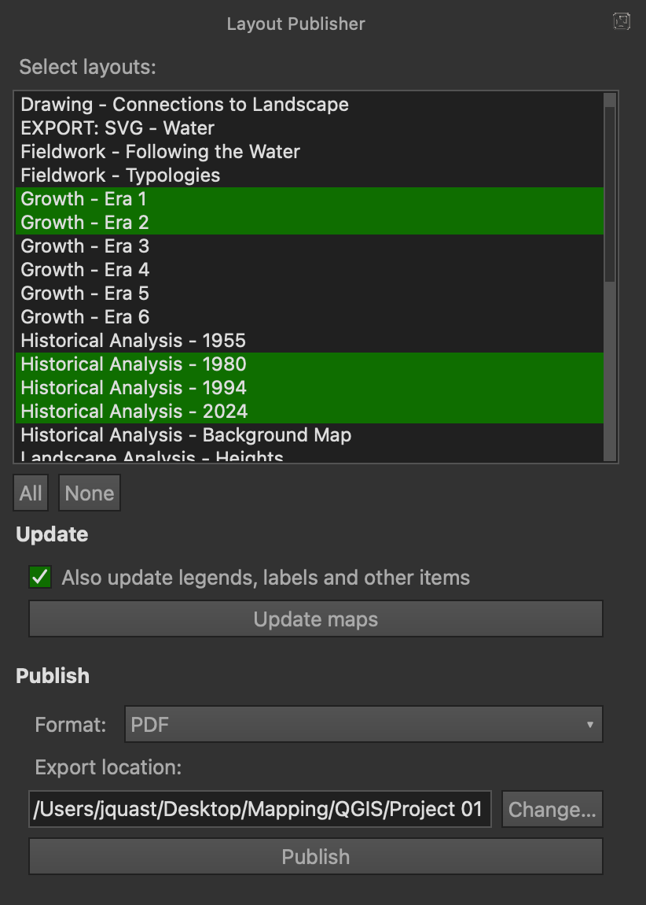
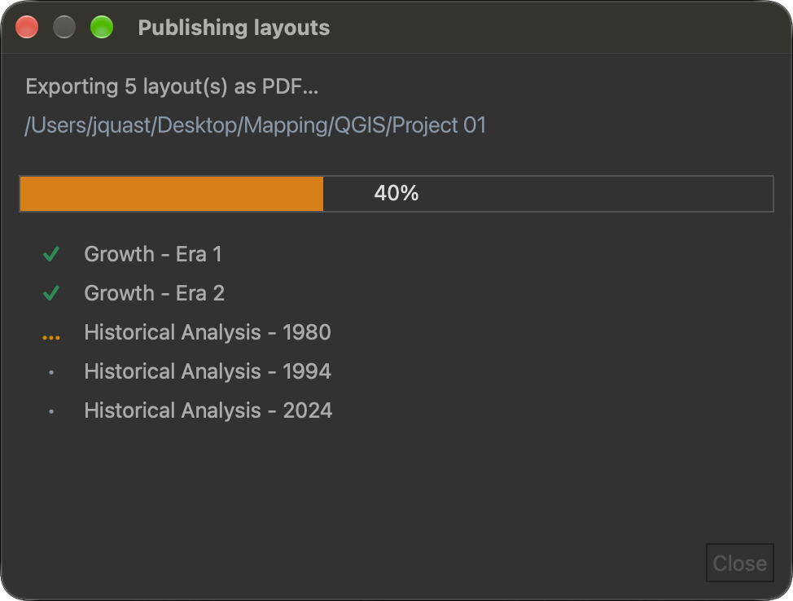

# layout_publisher
QGIS plugin that lets the user refresh and publish multiple print layouts at once.

Instead of opening each print layout, refreshing its maps and exporting it by
hand, Layout Publisher adds a dockable panel to the QGIS main window. It lists
all print layouts of the current project. You pick the ones you want, then
refresh their maps or export them as PDF, PNG or SVG into a folder of your
choice.


</br>


## Features

- Dockable panel listing all print layouts of the current project, kept in sync
  when layouts are added, renamed or removed, or another project is opened
- Multi-selection, plus **All** / **None** buttons
- A message in place of the list when there are no layouts, or no project is
  open
- Double-click a layout to open it in the layout designer
- **New layout:** the button above the list creates an empty print layout (with
  the same dialog as QGIS's Layout Manager) and opens it in the layout designer
- **Rename:** change the name of the selected layout directly from the panel
- **Refresh:** refresh the map items, the other items (legends, labels, scale
  bars, tables, ...) or both in the selected layouts
- **Publish:** export the selected layouts as **PDF**, **PNG** or **SVG**
- A default **export location** that is remembered between sessions
- A progress window while publishing, with a green check next to every
  layout that was exported and a red cross (with the error as tooltip) for any
  that failed
- **Stop** an export from the progress window; the remaining layouts are
  skipped

## Requirements

- QGIS 3.30 or newer
- No additional Python packages

## Installation

**From the QGIS Plugin Manager:**

1. In QGIS, open **Plugins → Manage and Install Plugins…**
2. Search for **Layout Publisher** and click **Install Plugin**.

**From a ZIP file:**

1. Download the plugin as a ZIP file from
   https://plugins.qgis.org/plugins/layout_publisher/. The ZIP must contain a
   single top-level folder named `layout_publisher`.
2. In QGIS, open **Plugins → Manage and Install Plugins… → Install from ZIP**
   and select the file.

To create the ZIP yourself, run this in the repository folder:

```bash
git archive --format=zip --prefix=layout_publisher/ -o layout_publisher.zip HEAD
```

It packs the plugin as of the last commit into a `layout_publisher` folder and
leaves out everything that isn't needed to run it (tests, docs, git and editor
files; see `export-ignore` in `.gitattributes`). Don't use Finder's
"Compress" command on macOS: it adds a `__MACOSX` folder that QGIS tries to
load as a plugin, and it would include all of those files.

## Usage

1. Open the panel with the Layout Publisher button in the toolbar, or via
   **Plugins → Layout Publisher**. Use the same button to hide it again.
2. To create a layout, click the button above the list (a sheet with a green
   plus), enter a name (or leave it empty for a generated one) and click
   **OK**. The new, empty layout opens in the layout designer.
   Double-click a layout in the list to open it in the layout designer.
   Select one or more layouts in the list (Ctrl/Cmd-click or Shift-click, or
   use **All**).

### Refreshing layouts

3. Choose what to refresh: **Maps**, **Other items** (legends, labels, scale
   bars, tables, ...) or both. Refreshing maps can take a while for large
   layouts; the other items are quick. The **Refresh** button is only enabled
   when at least one option is ticked.
4. Click **Refresh**. A summary appears below the panel, for example
   *"Refreshed 6 map(s) and 14 other item(s) in 3 layout(s)."*

"Refresh" re-renders the items with the current state of the project, for
example after you changed layer styles, data or a map theme: a map that follows
a map theme shows the theme’s current layers. It does not change any item’s
settings, such as a map’s extent, scale, locked layers or the theme it follows.

### Publishing layouts

3. Choose the export format, **PDF**, **PNG** or **SVG**.
4. Click **Set…** and choose the folder to export to. The button changes to
   **Change…** once a folder is set. The folder and format are remembered.
5. Click **Publish**. A progress window opens and shows each layout as it is
   exported. When it says *Done*, click **Close**.

To stop an export, click **Stop** in the progress window (or press Esc). The
layout that is currently being exported is finished first; the remaining
layouts are skipped and marked with a grey dash.

Files are named after the layout, for example `Site plan.pdf`. Characters that
aren't allowed in file names (`\ / : * ? " < > |`) are replaced with `_`.

## Known limitations

The plugin does only what is listed above. Please be aware of the following:

- **Atlas layouts** are exported like normal layouts, as a single file. There
  is no export of one file per atlas page.
- **Export settings can't be changed.** Layouts are exported with QGIS's
  default PDF, image and SVG export settings, so resolution follows each
  layout's own export resolution. There are no options for DPI, compression,
  metadata or other settings in the panel.
- **Only PDF, PNG and SVG** are supported (no JPEG, TIFF, ...).
- **SVG has limits.** SVG can't represent everything a layout can contain
  (for example some blend modes and effects), and raster content such as
  basemaps is embedded as images. Check SVG exports before using them.
- **Existing files are overwritten** without asking if a file with the same
  name is already in the export folder.
- **File name collisions:** because special characters are replaced with `_`,
  two layouts such as `A/B` and `A:B` would both become `A_B` and the second
  would overwrite the first.
- **Multi-page layouts** exported as PNG or SVG may produce one file per
  page, with the file naming for additional pages decided by QGIS. This
  hasn't been tested thoroughly.
- **Stop takes effect between layouts.** Each layout is exported on QGIS's
  main thread, so QGIS can briefly seem unresponsive while a large layout is
  rendered. The progress window only updates between layouts, and a click on
  Stop ends the export only after the current layout has finished.
- **Refresh doesn’t change map settings.** Maps are redrawn as they are set up
  in the layout designer. Their extent isn’t synced with the main map canvas,
  and their scale, locked layers and followed theme stay as they are.
- **Print layouts only.** QGIS *reports* are not supported. If your project
  contains reports they may appear in the list and will give an error when
  used.
- **One export location for all projects.** The folder and format are stored
  in your QGIS profile, not in the project.
- **Exports aren't verified.** A layout is shown as successful when QGIS
  reports success. The plugin does not inspect the written file.
- **Limited testing.** The plugin was developed and tested on macOS. It hasn't
  been tested on Windows or Linux, or on QGIS 4 (Qt6), so Qt6 support is not
  declared yet.
- The interface is in **English only**.

## Possible future features

These are ideas, not promises, and they are in no particular order:

- Export atlas layouts, one file per atlas page
- Combine all exported PDFs into one file
- Settings for export resolution (DPI) and other PDF/PNG/SVG options
- More formats, such as JPEG or TIFF
- Ask before overwriting, or choose a file name pattern (for example with a
  date or the project name)
- Keeping the interface responsive while exporting, and stopping during a
  layout's export
- Store the export location per project
- Set up a folder structure for exported layouts
- Support for QGIS reports
- Qt6 / QGIS 4 compatibility and testing on Windows and Linux
- i18n Translations
- Rename several layouts at once (for example with a prefix/suffix or find/replace)

Suggestions are welcome. Open an issue and describe how you'd use it.

## Reporting problems and contributing

Bug reports and feature requests go to the
[issue tracker](https://github.com/jo-quast/layout_publisher/issues). When
reporting a bug, please include your QGIS version, your operating system and
any error text shown in the panel or in the Python console
(**Plugins → Python Console**) or the **Log Messages** panel.

Pull requests are welcome. Please keep the code PEP 8 compliant (maximum line
length 100), add docstrings for new classes and methods, and add or update
tests for your changes.

### Running the tests

The tests use [pytest](https://pytest.org) and
[pytest-qgis](https://github.com/GispoCoding/pytest-qgis). They need QGIS's
own Python, because the `qgis` module ships with QGIS and can't be installed
with pip. Install the two packages into it once:

```bash
/Applications/QGIS.app/Contents/MacOS/python -m pip install --user pytest pytest-qgis
```

Then run the tests from the repository folder:

```bash
/Applications/QGIS.app/Contents/MacOS/python -m pytest
```

These paths are for macOS. On Windows and Linux, use the Python that comes
with your QGIS installation instead (on Windows, for example, from the
OSGeo4W Shell). The tests run QGIS without a window, so QGIS doesn't need to
be open. The repository folder must be named `layout_publisher`, because the
tests import the plugin under that name.

## Development

This plugin was developed with the help of Claude, an AI assistant by
Anthropic, which generated much of the initial code and documentation. I
engineered, reviewed, tested and adapted the result and am responsible for
the plugin and its maintenance.

I also use this project to learn Python and PyQGIS, so I now work with
[Claude Code](https://claude.com/claude-code) as a pair programmer. I write
new features, fixes and tests myself. Claude Code explains the PyQGIS and Qt
APIs I need, and reviews my changes. It also helps with documentation such as
docstrings, this README, the changelog, with packaging and git tasks.

## License

Layout Publisher is free software, released under the
[GNU General Public License, version 3](LICENSE).

## Author

Jonathan Quast